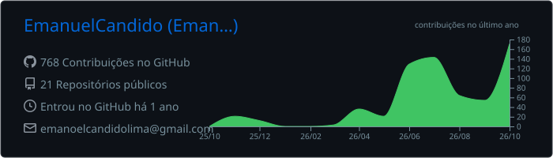
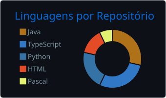
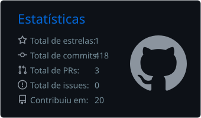

# Olá, eu sou o Emanuel Cândido 👋

**Estudante de Engenharia de Software na UNIFSA (Teresina/PI), focado em back-end com Java e Spring
Boot, e pesquisador PIBIC em IA generativa.**

Gosto de transformar problemas reais em software que alguém usa de verdade: uma plataforma de casos
clínicos para professores da saúde, um sistema de agendamento para uma barbearia, um jogo educativo
para crianças e um app de notas que eu mesmo uso todo dia.

- 🔬 **Agora:** pesquisador de iniciação científica (PIBIC) no Centro Universitário Santo Agostinho,
  desenvolvendo o back-end do [ClinicCase](https://github.com/EmanuelCandido/ClinicCase), que usa
  LLM + RAG para gerar casos clínicos e perguntas avaliativas.
- 🎯 **Busco:** estágio ou primeira vaga em desenvolvimento back-end ou full stack.
- 📫 **Contato:** [emanoelcandidolima@gmail.com](mailto:emanoelcandidolima@gmail.com) ·
  [LinkedIn](https://www.linkedin.com/in/emanuelcandidodasilvalima/) ·
  [Portfólio](https://emanuelcandido.github.io/Portifolio/)

---

## 🚀 Projetos em destaque

| Projeto | O que é | Stack |
| --- | --- | --- |
| [**ClinicCase**](https://github.com/EmanuelCandido/ClinicCase) | Plataforma educacional que gera casos clínicos com IA generativa (LLM + RAG) para professores da saúde. Projeto do PIBIC, apresentado no Opala Tech V e no DELTA Saúde 2026. | Java · Spring Boot · Spring Security · PostgreSQL · Flyway · React · Docker |
| [**TopNote**](https://github.com/EmanuelCandido/TopNote) | App de notas rápidas para Windows: abre por um atalho global, organiza por projetos e guarda tudo localmente. | Tauri · Rust · React · TypeScript · SQLite |
| [**Sistema de barbearia**](https://github.com/EmanuelCandido/Sistema-de-barbeiro) | Agendamento feito sob encomenda para uma barbearia: experiência mobile para clientes e painel para o dono, com regras de segurança testadas. | React · TypeScript · Firebase · Vite |
| [**Eco City**](https://github.com/EmanuelCandido/Jogo_INOVATECH) | Jogo educativo 3D no navegador que ensina sustentabilidade a crianças por meio de decisões e consequências. Feito para o Inovatech do Colégio Propósito. | React · Three.js · TypeScript · Vite · Vitest |
| [**Porta a Porta**](https://github.com/EmanuelCandido/porta-a-porta) | Roguelite de ação isométrica de Halloween, publicado no [itch.io](https://emanuelcandido.itch.io/porta-a-porta) para uma game jam, com simulação determinística e centenas de testes. | Phaser 4 · TypeScript · Vite · Playwright |
| [**MyVitory**](https://github.com/EmanuelCandido/myvitory) | App Android de treino que recalcula a semana quando você falta, respeitando o descanso de cada músculo. | Kotlin · Jetpack Compose · Room |
| [**Link na Bio**](https://github.com/EmanuelCandido/link-na-bio) | Página de links para profissionais que vendem pelo Instagram, com painel de edição e métricas próprias. | Node.js · JavaScript · Netlify |
| [**Vendas e estoque**](https://github.com/EmanuelCandido/Estoque-de-vendas) | Sistema de vendas que integra a aplicação com View, Function e Procedure reais do PostgreSQL. | Python · Flask · PostgreSQL · PL/pgSQL |

---

## 🛠️ Tecnologias

**Back-end e dados**

**Front-end, desktop e mobile**

**Ferramentas**

---

## 📊 GitHub

  

  
  

---

## 🤝 Conecte-se comigo

  
  
  

